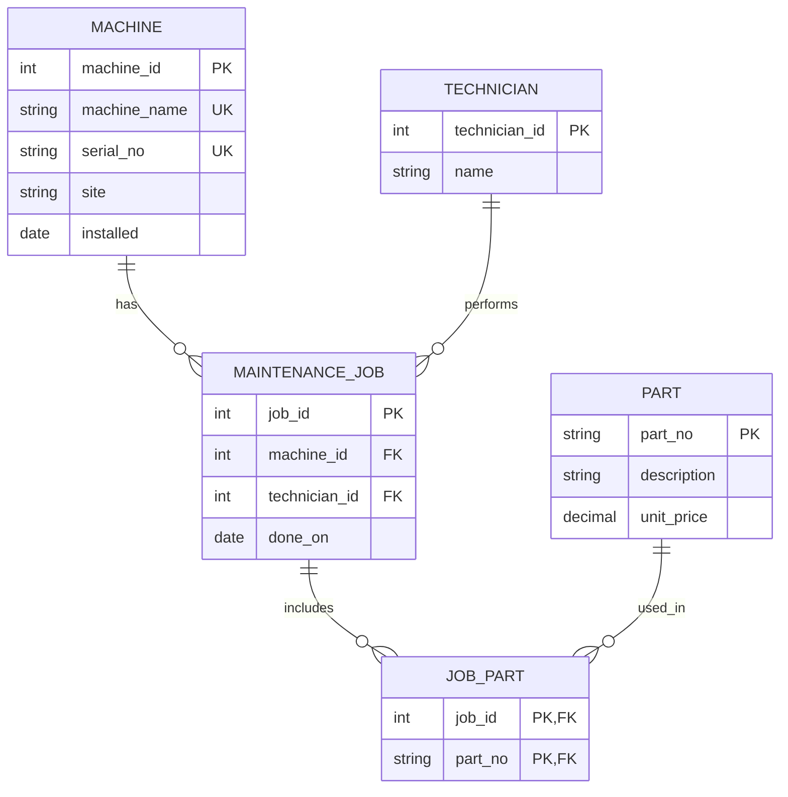

# Task 1 — Reconstruct the intended ER model

## Entities, attributes and intended keys

| Entity | Legacy columns / intended columns | Intended primary key | Important correction |
|---|---|---|---|
| `Machine` | `machine_name`, `serial_no`, `site`, `installed`; add `machine_id` | `machine_id` (surrogate) | `serial_no` remains UNIQUE; `machine_name` is a label, not a job FK. |
| `Part` | `part_no`, `description`, `unit_price` | `part_no` (natural) | Enforce uniqueness and use numeric pricing. |
| `MaintenanceJob` | `job_id`, `machine_name`, `technician`, `done_on`, `parts_used`; replace strings with FKs | `job_id` | Add `machine_id` and `technician_id`; remove `parts_used`. |
| `Technician` | `name` extracted from legacy `maint_job.technician`; add `technician_id` | `technician_id` | Names need not identify people uniquely. |
| `JobPart` | `job_id`, `part_no` (new junction table) | `(job_id, part_no)` composite | A given part appears at most once per job. |

**Note:** only Machine, Part and MaintenanceJob are *physical legacy tables*. Technician and JobPart are inferred entities in the repaired design, not present in the supplied schema. `machine_name` is marked UNIQUE in the proposed contract to make legacy name lookup unambiguous, although uniqueness/mutability should be confirmed with the business.

## Reconstructed diagram (Mermaid)



[Mermaid source](er-diagram.mmd) — paste into https://mermaid.live/ if your Markdown viewer does not render it.

## Cardinality: exact SQL evidence

### One machine → many jobs (intended 1:n)

```sql
SELECT m.machine_name, COUNT(j.job_id) AS n_jobs
FROM machine AS m LEFT JOIN maint_job AS j
  ON j.machine_name=m.machine_name
GROUP BY m.machine_name ORDER BY m.machine_name;
```

```text
machine_name | n_jobs
-------------+-------
RANDOM-NAME  | 0     
cnc-01       | 2     
cnc-02       | 1     
cnc-03       | 0     
```

Among **registered machines**, `cnc-01` has 2 jobs, `cnc-02` has 1 and the other two have 0; job 3 belongs to nonexistent `cnc-05` and cannot be joined. The counts support 1:n patterns but **do not enforce** the intended rule.

### One technician → many jobs (intended 1:n)

```sql
SELECT technician, COUNT(*) AS n_jobs
FROM maint_job GROUP BY technician ORDER BY technician;
```

```text
technician | n_jobs
-----------+-------
Beier      | 2     
Klaas      | 1     
Werther    | 1     
```

`Beier` appears on two jobs, suggesting repeat work by a technician; the legacy string does not prove two identical names represent the same person.

### Many jobs ↔ many parts (intended m:n)

```sql
SELECT job_id, parts_used,
 CASE WHEN parts_used IS NULL THEN 0
 ELSE LENGTH(parts_used)-LENGTH(REPLACE(parts_used,',',''))+1 END AS n_parts
FROM maint_job ORDER BY job_id;
```

```text
job_id | parts_used    | n_parts
-------+---------------+--------
1      | P-1001,P-1002 | 2      
2      | P-1003        | 1      
3      | P-1001        | 1      
4      | NULL          | 0      
```

Job 1 uses two parts. Next, split CSV tokens *for audit purposes* (not as a permanent join):

```sql
WITH RECURSIVE tokens(job_id, remaining, token) AS (
 SELECT job_id, COALESCE(parts_used,'')||',', '' FROM maint_job
 UNION ALL
 SELECT job_id, SUBSTR(remaining,INSTR(remaining,',')+1),
        TRIM(SUBSTR(remaining,1,INSTR(remaining,',')-1))
 FROM tokens WHERE remaining<>''
)
SELECT token AS part_no, COUNT(DISTINCT job_id) AS n_jobs
FROM tokens WHERE token<>'' GROUP BY token ORDER BY token;
```

```text
part_no | n_jobs
--------+-------
P-1001  | 2     
P-1002  | 1     
P-1003  | 1     
```

Part `P-1001` occurs in jobs 1 and 3; therefore the supplied records contain **both directions** of m:n. The solution is `job_part(job_id,part_no)`.

## 1:1 vs 1:n vs m:n (one sentence each)

- **1:1:** Not explicitly present or enforced in this legacy schema; a nameplate would require a separate 1:1 table and UNIQUE FK if modeled separately.
- **1:n:** Machine–MaintenanceJob and Technician–MaintenanceJob are implied by text values but not enforced by foreign keys.
- **m:n:** MaintenanceJob–Part is hidden in comma-separated `parts_used` and needs a junction table.

## Unencoded business rules / migration questions

- Does a job always require an existing machine and an identified technician? The proposed contract says yes.
- Can an order have zero parts? The proposed junction table allows this (job 4).
- How should the orphan `cnc-05` job be corrected? Do **not** silently invent a machine.
- How should `RANDOM-NAME`'s `installed='unknown'` be corrected? Investigate before migrating; do **not** fabricate a date.
- Is the duplicate `P-1003` row truly accidental? Confirm and deduplicate before adding the PK.
- Are machine names unique and stable, and do technicians share names? Decide identity from business rules, not the sample alone.
