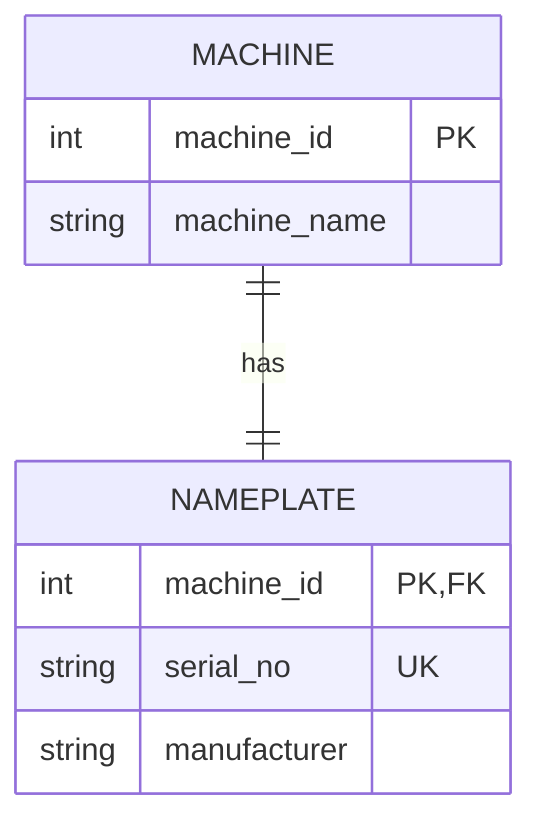
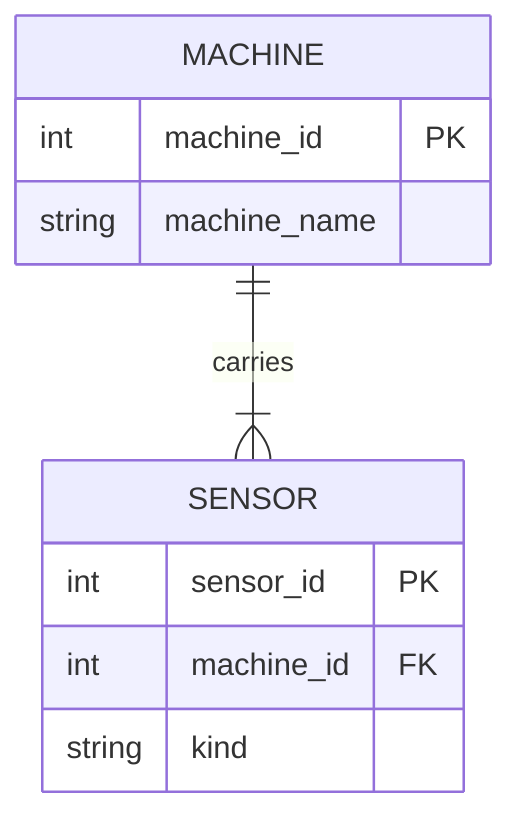
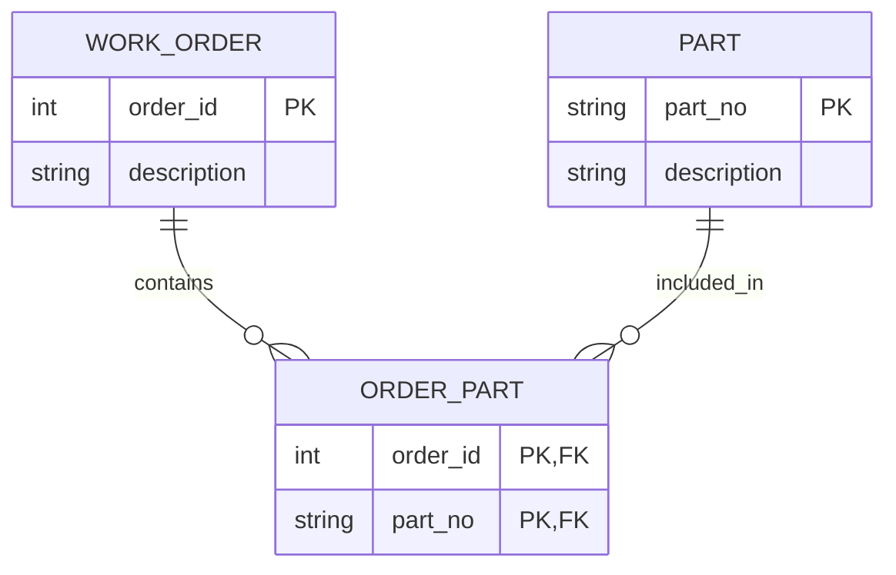
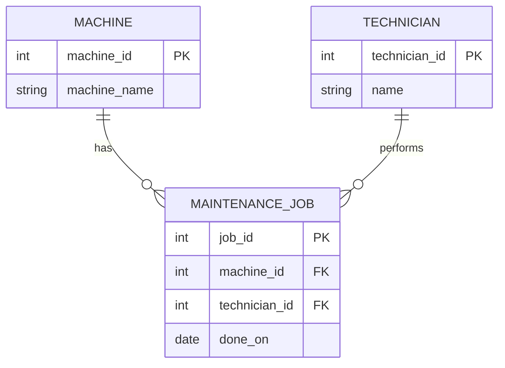

# Module 02 — Task B: Four ER Sketches and One SQL Proof

These four ER sketches show the scenarios from Task B. `PK` means primary key and `FK` means foreign key.

## 1. One-to-one: Machine and Nameplate

A machine has exactly one nameplate, and each nameplate belongs to exactly one machine.



**Design decision:** I model the nameplate as a separate entity because it has its own attributes. `NAMEPLATE.machine_id` is both primary key and foreign key, so each machine can have at most one nameplate. An application or additional database procedure may be needed to guarantee **every** machine has one at all times; the FK alone only guarantees that every nameplate belongs to an existing machine.

## 2. One-to-many: Machine and Sensor

Each machine carries many sensors; every sensor is installed on exactly one machine.



**Design decision:** The foreign key `SENSOR.machine_id` is on the **many** side. `NOT NULL` and a foreign key ensure each sensor references exactly one existing machine. Requiring at least one sensor on each machine is an extra business rule; a plain FK does not enforce that minimum.

## 3. Many-to-many: Work Order and Part

One work order can use many parts; one part can appear on many work orders. The same part must not appear twice within the same order.



**Design decision:** A junction table `ORDER_PART` is required. Its **composite primary key** `(order_id, part_no)` prevents the same part from being listed twice in one order.

## 4. Maintenance job as an entity

A maintenance job occurs on one machine, is performed by one technician, and has one date. A technician can perform many jobs.



**Design decision:** A job is an entity because it has its own identity (`job_id`), date, and relationships. `TECHNICIAN` should be an entity rather than only a name because the same technician performs multiple jobs and names need not be unique.

## SQL demonstration — one machine, two sensors

This SQL example creates a machine and two sensors, then counts how many sensors belong to each machine.

```sql
PRAGMA foreign_keys = ON;
CREATE TABLE machine_demo (
    machine_id INTEGER PRIMARY KEY,
    machine_name TEXT NOT NULL
);
CREATE TABLE sensor_demo (
    sensor_id INTEGER PRIMARY KEY,
    machine_id INTEGER NOT NULL REFERENCES machine_demo(machine_id),
    kind TEXT NOT NULL
);
INSERT INTO machine_demo VALUES (1, 'cnc-01');
INSERT INTO sensor_demo VALUES
    (10, 1, 'temperature'),
    (11, 1, 'vibration');
SELECT machine_id, COUNT(*) AS sensor_count
FROM sensor_demo
GROUP BY machine_id;
```

**Result:**

```text
machine_id | sensor_count
1          | 2
```

**What this proves:** Both sensors can reference the same machine: a **1:n** design. The foreign key prevents a sensor from referring to a nonexistent machine (while `PRAGMA foreign_keys = ON` is in force). A count of two alone does not prove the full business rule for every possible database state.
