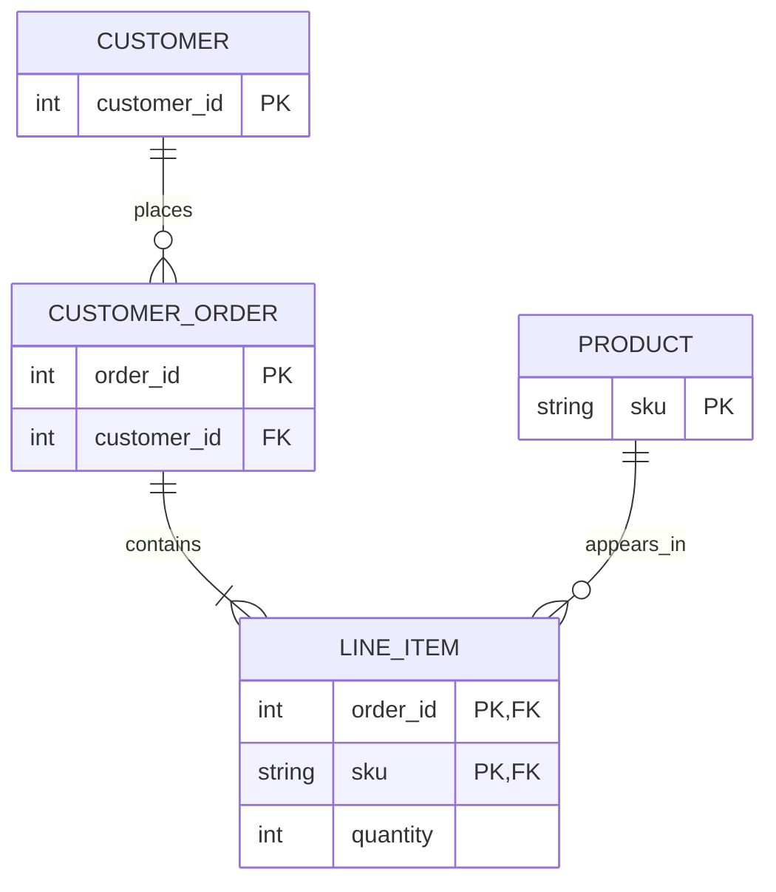
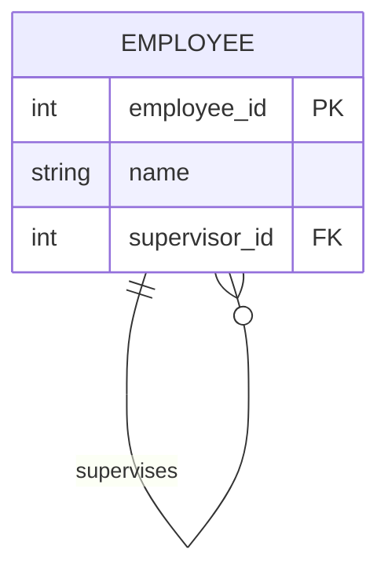
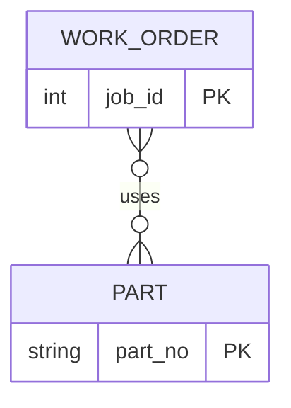

# Task 5 (optional) — Mermaid ER diagram notebook

These are **redrawings/adaptations**, with the original learning references linked. The third is **deliberately wrong as a physical schema**, not a claim that the credited external article is incorrect.

## 1. Good: Order / line-item junction

Adapted from [Mermaid official ERD examples](https://mermaid.js.org/syntax/entityRelationshipDiagram.html). An order has line items, and a product can be referenced on many line items. This replaces the direct order-product m:n with a junction entity.

**Lesson:** Associative `LINE_ITEM` has its own business field (`quantity`) and composite identifier; modeling a relationship as an entity can carry facts about that relationship. Here the model assumes a line is uniquely identified by order + SKU.

## 2. Strange: Recursive manager / employee

Adapted from [Vertabelo Academy's self-join employee/supervisor tutorial](https://academy.vertabelo.com/course/joins/self-join/introduction/introduction). One entity relates back to itself.

**Lesson:** Recursive 1:n uses an FK pointing to the *same table*. An employee can have no supervisor, but each employee has at most one direct supervisor. The diagram is a simplification; cycles must be prevented separately if prohibited by policy.

## 3. Wrong/confusing: direct m:n sketched as if it were finished relational DDL

Our own **deliberately incomplete sketch** demonstrates the m:n notation discussed in [Lucidchart's guide](https://www.lucidchart.com/blog/types-of-entity-relationship-diagrams). It works as a *conceptual* statement, not as a complete relational physical schema.

**Problem:** Without `JOB_PART(job_id,part_no)` there is no table to store associations or enforce no repeated part within the same work order. Do not confuse a valid *conceptual* m:n drawing with its relational implementation.

## Schema ↔ diagram round-trip (verified)

1. **Schema → diagram:** The sample has three legacy tables, but no PK/FK declarations. The repaired diagram in [`er-audit.md`](er-audit.md) adds `Technician`, a `JobPart` junction and proper keys. These additions are **inferences from the task's business requirements**, not relationships detected through actual legacy FK metadata.
2. **Diagram → schema:** [`roundtrip.sql`](roundtrip.sql) implements all five entities/relations in the repaired diagram. Ran it in SQLite, inspected `sqlite_master` and `PRAGMA foreign_key_list` (see `roundtrip-check.txt`). There are **5 tables and 4 FK references**: 1 Job→Machine, 1 Job→Technician, 2 Junction→parent tables. Its `job_part` composite PK disallows duplicated (job,part) pairs.
3. **What survived:** five entities, declared 1:n FKs, the m:n junction, natural part PK, and job-part composite PK.
4. **What a model could invent:** 1:1 nameplates, a compulsory minimum number of jobs, unique technician names, automatic correction of orphan `cnc-05`, or an invented install date. **None is justified by the given rows.** Cardinalities in the diagram express proposed business rules; counts show current patterns, not formal enforcement.

## Cardinality overuse

A claim like *a car has exactly four wheels* is a context-specific rule, not a universal ER cardinality. A spare wheel, heavy goods vehicle or trailer is a counterexample. Typically model `VEHICLE ||--o{ WHEEL` and enforce any application-specific count through validation or carefully designed DB logic; an ordinary row CHECK cannot count child rows. An exactly-N rule is legitimate only when the domain guarantees N under a defined condition.

## Inheritance overuse

Mermaid's ER diagram syntax does not express true disjoint/total EER specialization; a class diagram or constraints + annotations are needed. A `Vehicle → Car/Truck` hierarchy is sensible if the subtypes have major distinct structures or behaviors; with only a few subtype properties, a `vehicle_type` column plus checks is simpler. Likewise, a `Person → Customer/Employee/Student` hierarchy can overcomplicate a schema because one person may hold multiple roles simultaneously; model `person` and optional role-membership tables instead of forcing disjoint child classes.

## One-sentence Discord post (user must post)

"Our job–part diagram shows why a many-to-many relationship needs an explicit junction table: otherwise the SQL can't reliably record which part belongs to which job."

**Still manual:** render your chosen Mermaid diagram and post the image/source to Discord. This bundle does **not** claim to have posted it.
