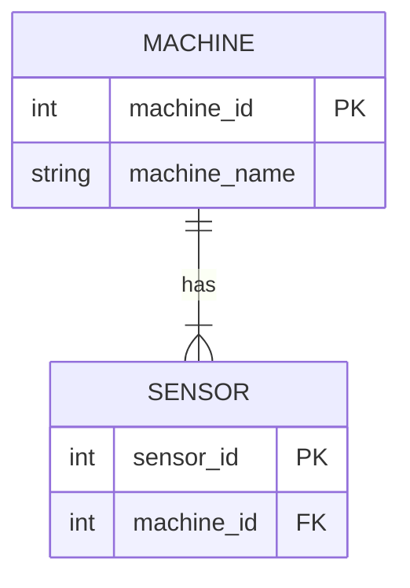
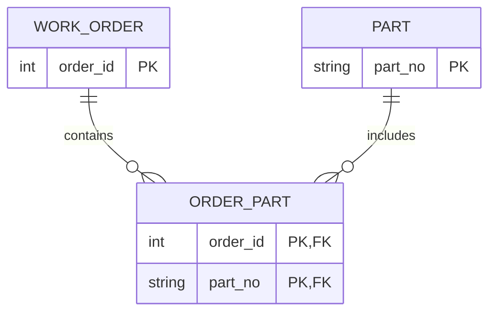

# Module 02 — Study Log (Tasks A and C)

## Task A — Sources and key ideas

| Source | What I learned |
|---|---|
| Module 2 course material, *Data Contracts & Reading Legacy Schemas* | The difference between entities, attributes and relationships, and how primary and foreign keys work. |
| My questions and explanations during study | How a maintenance job is linked to a machine, and why duplicate parts and incorrect data types cause problems. |

The module also links to the [SQLite foreign-key guide](https://www.sqlite.org/foreignkeys.html), the [Mermaid ER diagram guide](https://mermaid.js.org/syntax/entityRelationshipDiagram.html) and an [overview of ER models](https://en.wikipedia.org/wiki/Entity%E2%80%93relationship_model). These are useful references for the examples below.

## Questions I explored

| Question | What I understood | Related reference |
|---|---|---|
| How can two tables be connected? | A job can refer to a machine using its `machine_id`. | Module 2 material; [SQLite foreign keys](https://www.sqlite.org/foreignkeys.html) |
| Why is a comma-separated list of parts a problem? | It makes individual parts harder to find, count and join. | Module 2 material; [First normal form](https://en.wikipedia.org/wiki/First_normal_form) |
| How do I show one-to-many and many-to-many relationships? | One-to-many uses a foreign key on the many side; many-to-many uses a junction table. | Module 2 material; [Mermaid ER diagrams](https://mermaid.js.org/syntax/entityRelationshipDiagram.html) |

## Things I found interesting

- A maintenance job refers to machine `cnc-05`, but that machine is not in the machine table. This might be a typo or a missing machine record.
- Part `P-1003` is stored twice. Duplicate records can make counts and queries incorrect.
- A price stored as text might be compared like words rather than numbers; for example, `'9.90'` can be considered greater than `'15'` as text.
- The installation date `unknown` cannot be used in date calculations.
- Keeping `P-1001,P-1002` in one field makes it harder to find each part used in a job.

## LLM Q&A and how I checked the answers

**Question 1: How are database tables connected?**

A primary key identifies a record, and a foreign key links another table to it. For example, `machine_id = 2` in the maintenance-job table identifies machine `cnc-02` in our example. I checked my understanding by answering which machine ID 2 referred to, and by running the data-contract tests, including the foreign-key test.

**Question 2: Why is a duplicate part a problem?**

The same part might be counted twice or cause confusion. The audit shows two rows for `P-1003`, and the corrected schema's duplicate-key test passed.

**Question 3: Why should prices be stored as numbers?**

Text ordering is not the same as numeric ordering. The legacy audit demonstrates this with price values, and the corrected schema uses a numeric price field.

**Question 4: Why are invalid installation dates a problem?**

If the date is `unknown`, it is difficult to know when a machine was installed or plan maintenance from that date. The audit identifies the row with the invalid date.

**Question 5: Why should part numbers not be stored together in one field?**

It becomes harder to find and count each part. The legacy join misses job 1 because it has two part numbers in one field. In the corrected design, a junction table connects each job to its individual parts.

For the Python data contract, I ran the test script in Terminal and got **“All contract tests passed.”**

## Two ER examples I learned from

### Example 1 — Machine and sensors (1:n)

Based on the scenario in Task B of the course material.

I learned that the foreign key `machine_id` belongs in the `SENSOR` table because several sensors can belong to one machine.

### Example 2 — Work orders and parts (m:n)

Based on the work-order example in Task B of the course material.

I learned that the `ORDER_PART` table connects orders and parts without storing a list of part numbers in one cell. The pair `(order_id, part_no)` also prevents a part being listed twice on the same order.

My other two scenarios and a SQL example are in [er-examples.md](er-examples.md).

## Task C — Agreed learning (pod discussion)

During Tasks A–C, my peers and I studied entities, attributes and relationships. We explained the tasks to one another and talked about how tables connect using IDs. We also discussed the ER diagram image we wanted to share on Discord. Explaining the examples to each other made them easier to understand.

The main points I took from our discussion were:

1. An **entity** is something like a machine; an **attribute** describes it, such as its serial number.
2. A **primary key** identifies a record, while a **foreign key** connects it to another table.
3. Duplicate part records and references to missing machines can cause problems.
4. A **junction table** helps connect jobs and parts in a many-to-many relationship.

The diagram discussion focused on making these relationships clear enough for someone else to understand.
