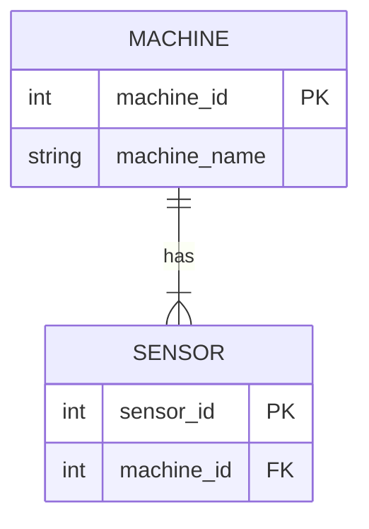
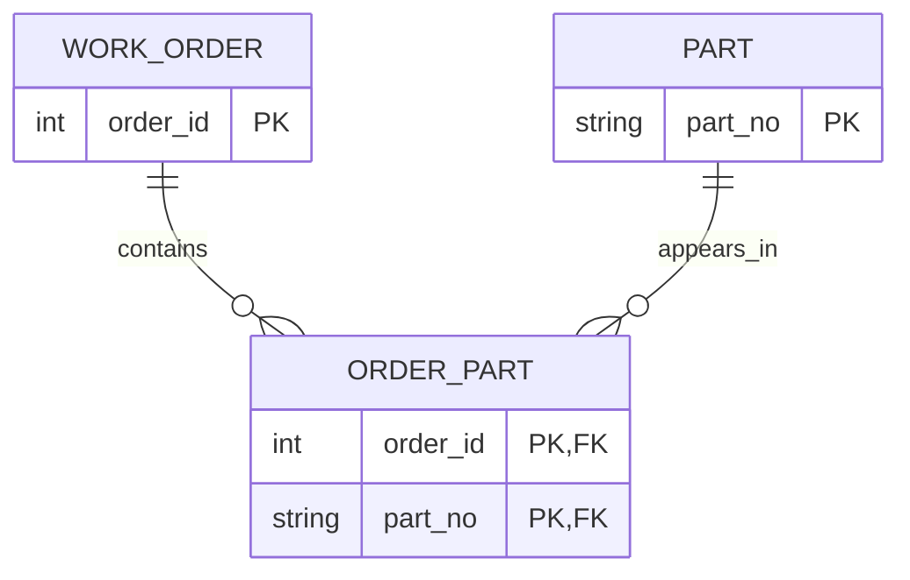

# Module 02 — Study Log (Tasks A and C)

> Study notes reconstructed from the Module 2 assignment and my subsequent learning conversation. These are not a claim that I completed undocumented Google searches or that our pod posted to Discord. Items requiring confirmation are clearly noted.

## Task A — Sources and what I learned

| Source | What it helped me understand |
|---|---|
| Module 2 assignment sheet *(provided in class)* | The difference between entities, attributes, primary/foreign keys, cardinalities, and data-integrity problems. |
| Discussion with an AI assistant while studying this module | Connecting tables using matching IDs: `machine.machine_id` identifies a machine; `maint_job.machine_id` references it. |
| [SQLite documentation — Foreign Keys](https://www.sqlite.org/foreignkeys.html) *(follow-up reference)* | Where to review how a foreign key prevents references to missing parent rows. This link is included for further reading; I have not documented reading it independently. |
| [Mermaid ER-diagram guide](https://mermaid.js.org/syntax/entityRelationshipDiagram.html) *(diagram reference)* | Where to review `erDiagram` syntax for one-to-one and one-to-many relationships. |

## Things I searched or looked up

- In my learning conversation, I asked: **"How are database tables connected?"** The explanation used a machine ID in the machine table and a matching machine ID in the maintenance-job table.
- **Google searches:** I did not record any specific searches or URLs, so I have not invented them. Add a real search here only if you did one.

## Remarkable findings (what surprised me)

- A maintenance job can refer to a machine that is missing from the machine list. Example: job 3 mentions `cnc-05`, which does not exist in the sample `machine` table.
- The part number `P-1003` appears twice; it is not unique in the old database.
- Saving a price as text can cause incorrect comparisons: alphabetic ordering is not the same as numeric ordering.
- A machine installation date can be `unknown` rather than a valid date.
- Saving `P-1001,P-1002` in one field makes it difficult to find each part separately.

## LLM questions, answers, and checks

### Q1. How are database tables connected?

**Answer summary:** A primary key uniquely identifies a row, while a foreign key in another table points to it. For example, if machine ID 2 belongs to `cnc-02`, then a maintenance job with `machine_id = 2` refers to `cnc-02`.

**How I checked:** I used the example and correctly identified `cnc-02` when asked which machine ID 2 refers to. I also ran the corrected data-contract tests; the foreign-key orphan-job test passed.

### Q2. Why does a duplicate part record matter?

**Answer summary:** Duplicate data can confuse staff, cause inaccurate counts, and create ordering or billing mistakes. A unique key on `part_no` prevents duplicates.

**How I checked:** The provided defect query finds `P-1003` twice in the legacy sample. The corrected contract test for duplicate part keys passed.

### Q3. Why are prices stored as text a problem?

**Answer summary:** Text values can be compared character by character rather than as money. The text `'9.90'` can sort above `'15'`, even though 9.90 is numerically smaller.

**How I checked:** The assignment's text-comparison query demonstrates the problem on the sample data; the corrected schema uses `NUMERIC(9, 2)`.

### Q4. Why are unknown dates and comma-separated parts a problem?

**Answer summary:** `unknown` is not a usable installation date. A list of part numbers in one text field makes it hard to join and count individual parts; a junction table solves the latter problem.

**How I checked:** I discussed both examples during review, and the SQL audit documents the invalid date and the join that omits a job using two parts.

## Two useful ER examples (my Mermaid redraws)

**Example 1 — one machine to many sensors.** Based on the course's Task B example and [Mermaid ER notation](https://mermaid.js.org/syntax/entityRelationshipDiagram.html). This illustrates that the foreign key belongs on the many side.

**What I learned that was useful:** The `machine_id` field appears in `SENSOR` as the foreign key, not as a comma-separated list of sensors in `MACHINE`.

**Example 2 — work orders and parts (many-to-many).** Based on the course's Task B example and [entity–relationship modeling](https://en.wikipedia.org/wiki/Entity%E2%80%93relationship_model). The two links via `ORDER_PART` turn a many-to-many relationship into two one-to-many relationships.

**What I learned that was useful:** A junction table can prevent adding the same part twice to one order through a combined primary key `(order_id, part_no)`.

Full-sized sketches for all four Task B situations are in [`er-examples.md`](er-examples.md).

## Task C — Agreed learning (pod discussion)

During Tasks A–C, I studied entities, attributes, and relationships with peers. We explained the tasks to each other, discussed how tables are connected, and talked about which ER diagram image would be best to share on Discord. Explaining the examples aloud helped my understanding.

**Points I took away from the discussion (confirm which ones your pod jointly agreed on):**

1. An entity is a thing, such as a machine; an attribute describes it, such as its serial number.
2. Tables can connect through a primary key and a foreign key.
3. Duplicate data and references to nonexistent machines can cause real problems.
4. A many-to-many relationship needs a junction table in a relational schema.

**Unresolved disagreements:** None were recorded in my notes; this does not mean none occurred.

**Discord image:** We discussed which image to share, but I have not confirmed that anyone posted it. Check the course Discord and post the chosen image with a short explanation if it is still missing.

Suggested one-sentence note for the post (adapt to your group's actual choice): "We chose this diagram because it clearly shows how a junction table connects maintenance jobs and parts."
