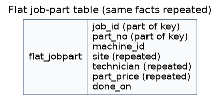
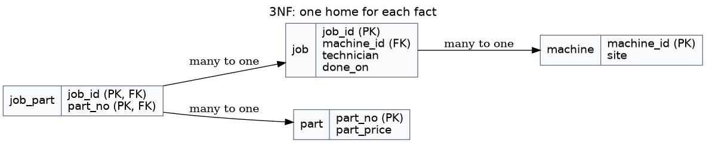

# Round 1 — Two ER sketches

## Before: flat model

The site and price are copied into many job-part rows. Editing one copy does not fix the others.

## After: normalized model (3NF)

- A machine has many jobs; a job belongs to one machine.
- A job has many parts and a part may appear on many jobs, linked through `job_part`.
- A part price is stored once in `part`. A machine site is stored once in `machine`.

**Gate question:** Which dependency disappears from the job-part row? `machine_id → site` and `part_no → part_price` no longer live in that row; they are represented in their own tables.

Editable diagram source is also supplied in `flat_model.dot` and `normalized_model.dot`.
